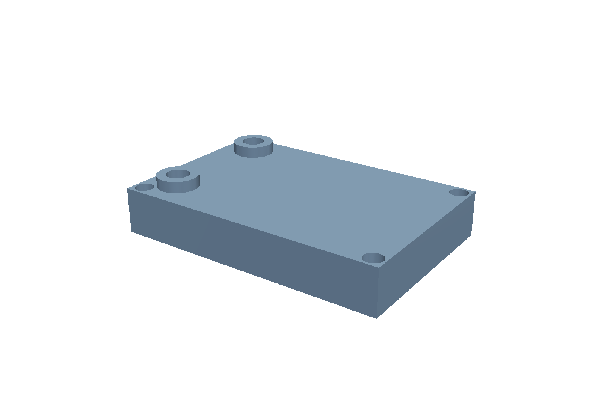
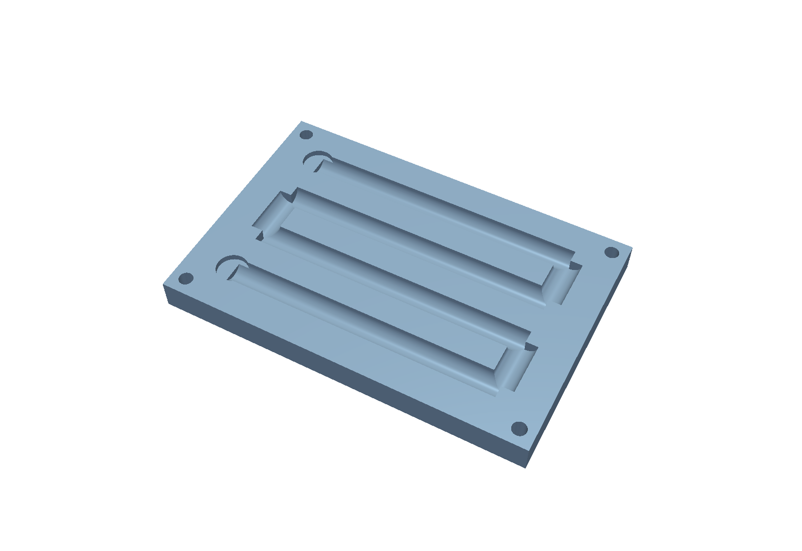
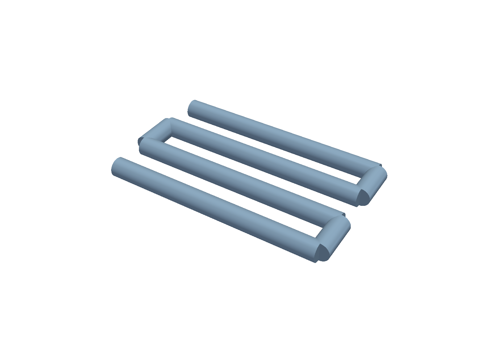
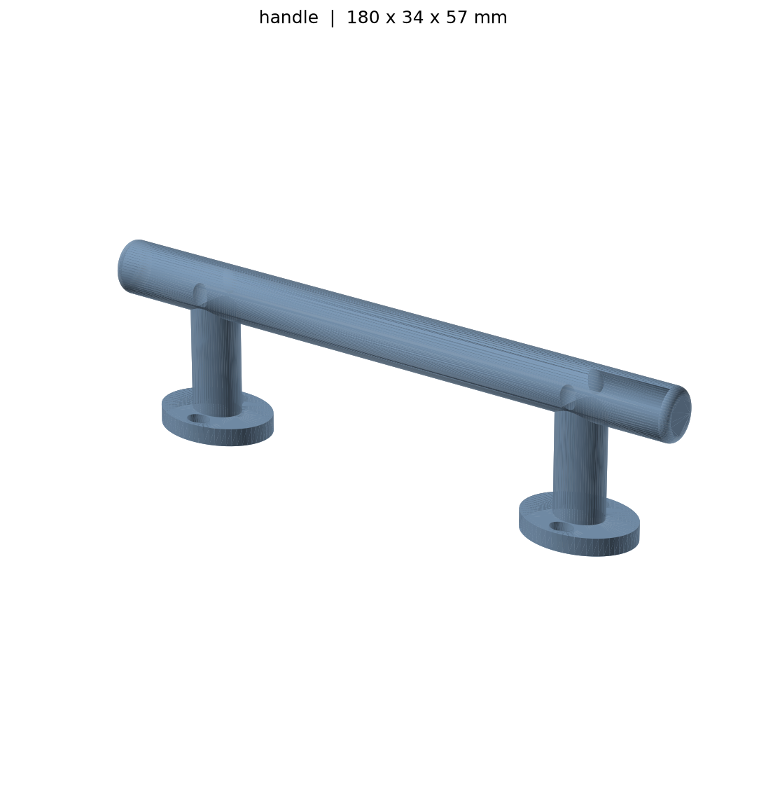

# Dark Agent Cad

An isolated, agent-ready CAD workspace for **build123d 0.10**, with a
watertight-geometry verifier, STEP export, and headless VTK previews. It is
designed to let a human or an AI coding agent generate a part, verify it, and
produce reviewable artifacts without opening a GUI.

## What is included

| Part | Script | STEP artifact | Verified size |
| --- | --- | --- | --- |
| Reference bracket | `scripts/template_part.py` | `exports/generated_bracket.step` | 100 x 50 x 14 mm |
| Pull handle | `scripts/handle.py` | `exports/handle.step` | 180 x 34 x 57 mm |
| Liquid-cooling block | `scripts/cooling_block.py` | `exports/cooling_block.step` | 120 x 80 x 25 mm |

The cooling block has an 8 mm internal four-pass serpentine channel, two 10 mm
vertical ports on 18 mm bosses, and four M4 counterbored mounting holes.

### Cooling block preview



### Section and internal flow path





The section is cut at Z = 10 mm. The separate channel render is a verification
aid: the channel void is exported as one connected, watertight solid.

### Pull handle preview



## Prerequisites

- **Python 3.12.x** (3.12.10 is tested). Do not use Python 3.13 or 3.14:
  AgentCAD 0.7.2 requires Python `<3.13`, and this workspace pins build123d
  0.10.0 because AgentCAD 0.7.2 requires build123d `<0.11`.
- Git.
- About 2 GB of free disk space for the virtual environment and dependency
  wheels.
- Windows PowerShell commands are shown below; `setup.md` contains POSIX
  equivalents.

## Quick start for humans

If you already have the repository folder, skip the clone and run the remaining
commands from its root.

```powershell
git clone <your-repository-url> Dark-Agent-Cad
cd Dark-Agent-Cad

py -3.12 -m venv cad-env
.\cad-env\Scripts\python.exe -m pip install --upgrade pip
.\cad-env\Scripts\python.exe -m pip install -r requirements.txt
```

Verify the environment and all three example parts:

```powershell
.\cad-env\Scripts\python.exe -m pip check
.\cad-env\Scripts\python.exe scripts\runner.py scripts\template_part.py --expect exports\generated_bracket.step
.\cad-env\Scripts\python.exe scripts\runner.py scripts\handle.py --expect exports\handle.step
.\cad-env\Scripts\python.exe scripts\runner.py scripts\cooling_block.py --expect exports\cooling_block.step
```

Each command should print `PASS` and exit with code `0`. The runner writes a
machine-readable report to `renders\verification_report.json` and a console log
to `renders\last_run.log`.

Render previews:

```powershell
.\cad-env\Scripts\python.exe scripts\render_step.py exports\handle.step renders\handle.png
.\cad-env\Scripts\python.exe scripts\render_step.py exports\cooling_block.step renders\cooling_block.png
.\cad-env\Scripts\python.exe scripts\render_step.py exports\cooling_block.step renders\cooling_block_section.png --cut-z 10 --elev 52 --azim -62
.\cad-env\Scripts\python.exe scripts\render_step.py exports\cooling_block.step renders\cooling_block_plan.png --cut-z 10 --elev 89.9 --azim -90
```

## Use this repository with a coding agent

Copy the prompt below into your agent. The prompt deliberately delegates the
details to `setup.md`, which is written as an agent-followable setup contract.

```text
You are an autonomous CAD setup and verification agent working in the Dark Agent
Cad repository. Read setup.md and follow it end to end.

Use Python 3.12.x and the pinned packages in requirements.txt. Do not upgrade
build123d beyond 0.11. Create the isolated cad-env virtual environment, install
the dependencies, verify the imports, and run all three example parts through
scripts/runner.py.

Do not change the intended part geometry to make a check pass. If something
fails, diagnose and fix the environment or the build123d API usage, then rerun
the failed check. Finish by reporting the environment versions, PASS/FAIL
results, artifact paths, and any deviations from setup.md.
```

If you are an agent already reading this file, open `setup.md` now and execute
its steps in order.

## Repository layout

```text
Dark-Agent-Cad/
├── README.md                 # Human instructions and the agent prompt
├── setup.md                  # Agent-followable setup and acceptance contract
├── requirements.txt          # Python 3.12 dependency pins
├── scripts/
│   ├── template_part.py      # Reference bracket geometry
│   ├── handle.py             # Parametric pull handle
│   ├── cooling_block.py      # Liquid-cooling cold plate
│   ├── runner.py             # Compile + import + watertight verifier
│   └── render_step.py        # Headless VTK STEP -> PNG renderer
└── examples/
    ├── README.md             # Notes on the checked-in reference artifacts
    ├── bracket.step          # Exported reference bracket
    ├── handle.step           # Exported pull handle
    ├── cooling_block.step    # Exported cooling block
    ├── cooling_channel.step  # Internal channel void, for inspection
    └── previews/             # Pre-rendered PNG previews
```

`cad-env/`, `exports/`, and `renders/` are generated locally and are ignored by
Git. The checked-in `examples/` files are known-good reference outputs.

## Make a new part

1. Copy `scripts/template_part.py` to `scripts/my_part.py` and edit the model.
2. Export with the build123d 0.10 function API:
   `export_step(part.part, "exports/my_part.step")`.
3. Run the verifier:

   ```powershell
   .\cad-env\Scripts\python.exe scripts\runner.py scripts\my_part.py --expect exports\my_part.step
   ```

4. Render a preview:

   ```powershell
   .\cad-env\Scripts\python.exe scripts\render_step.py exports\my_part.step renders\my_part.png
   ```

The runner performs a syntax check, runs the script inside `cad-env`, imports
the resulting STEP file back into OpenCascade, and requires at least one solid
that is valid, manifold/watertight, positive-volume, and has finite positive
bounding-box dimensions. A `PASS` is a geometry contract, not just a successful
file write.

## Verified reference results

| Part | Solids | Valid | Watertight | Volume (mm³) | Bounding box (mm) |
| --- | ---: | --- | --- | ---: | --- |
| Bracket | 1 | yes | yes | 49,207.345115 | 100 x 50 x 14 |
| Handle | 1 | yes | yes | 67,808.678012 | 180 x 34 x 57 |
| Cooling block | 1 | yes | yes | 170,270.571434 | 120 x 80 x 25 |

Small OpenCascade version differences can change the last few volume digits.
Treat a matching bounding box plus a valid, manifold solid as the hard
requirement; compare volume within about 0.1%.

## Troubleshooting

The full troubleshooting table and recovery commands are in `setup.md`. The
most common issues are:

- **Python 3.14 is selected:** AgentCAD 0.7.2 will not install. Install Python
  3.12 and create a fresh `cad-env` with `py -3.12 -m venv cad-env`.
- **The resolver installs build123d 0.13:** Do not install `build123d`
  unpinned. Create a fresh environment and install `-r requirements.txt`.
- **Disk space runs out while installing:** Point `TMP`/`TEMP` (PowerShell) or
  `TMPDIR` (POSIX) at a drive with room, and use `pip --no-cache-dir`.
- **`CounterBoreHole` is used in a sketch:** In build123d 0.10 it is a
  `BuildPart` operation; use it directly inside `BuildPart`.
- **`export_step` is called as a method:** build123d 0.10 uses
  `export_step(shape, path)`, not `shape.export_step(path)`.

## Notes

- All geometry is generated deterministically from Python; no network access is
  required to build the parts.
- `render_step.py` uses VTK offscreen rendering, which avoids the depth-sorting
  artifacts that simple painters-algorithm previews show on internal channels.
- AgentCAD is installed as part of the environment pin set, but the example
  runner does not require an AgentCAD server or viewer.
